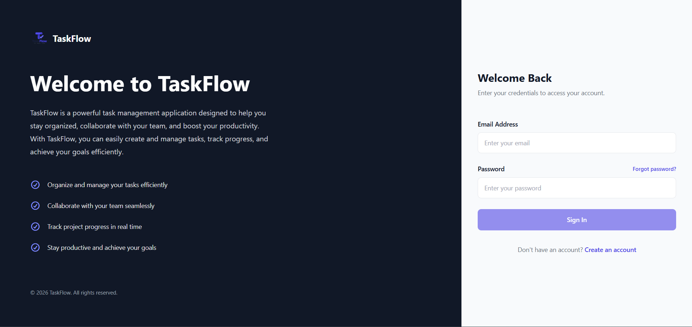
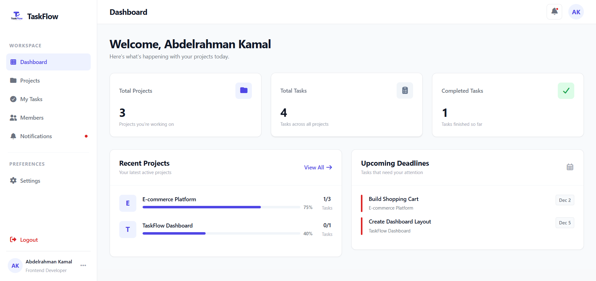
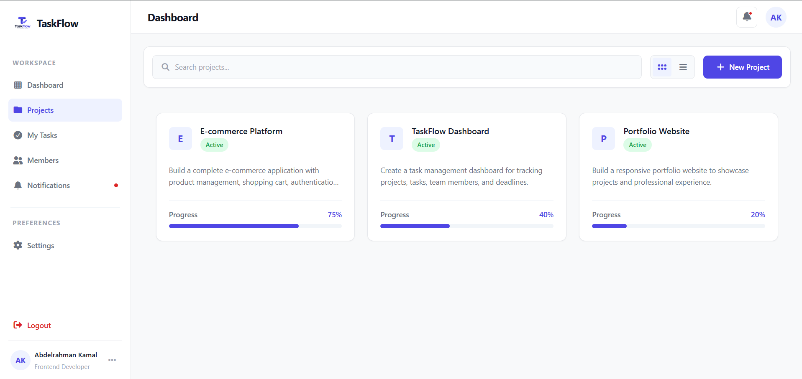
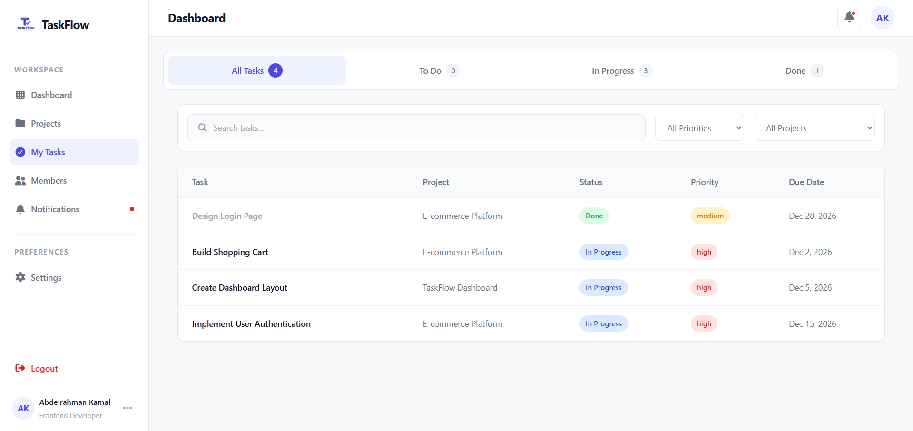
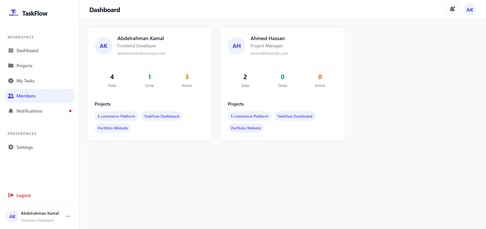
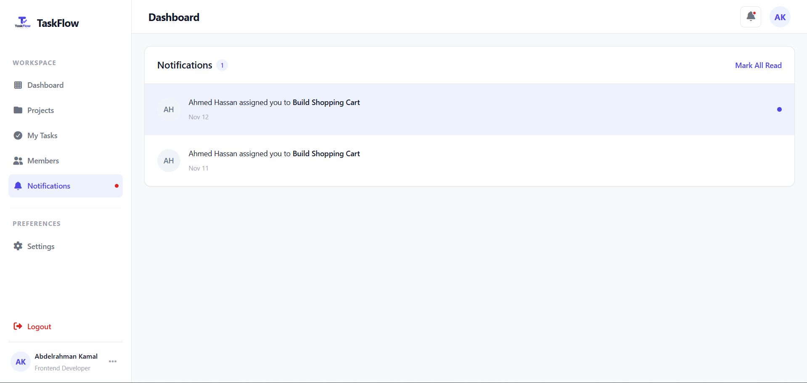
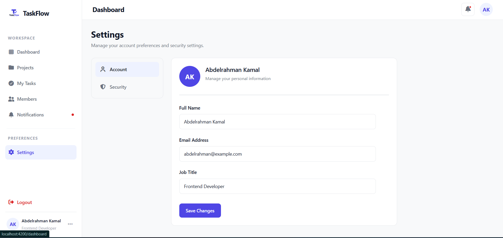
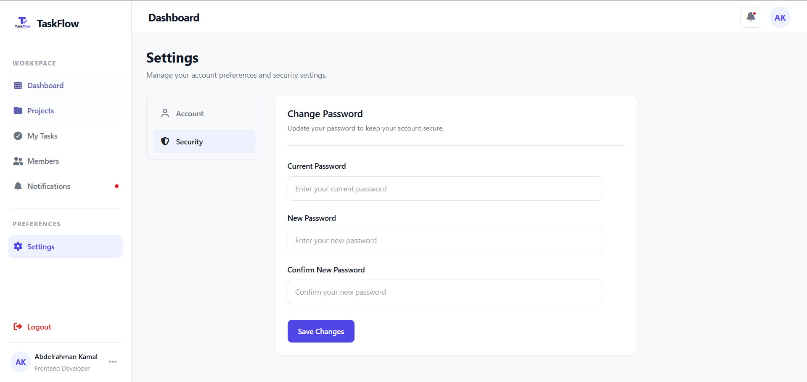

<div align="center">

# TaskFlow

**A modern task management app to organize projects, track progress, and collaborate with your team.**


</div>



[View the repository](https://github.com/abdosakoury78/Task-Management)

---

## Table of Contents

- [About](#about)
- [Features](#features)
- [Screenshots](#screenshots)
- [Tech Stack](#tech-stack)
- [Project Structure](#project-structure)
- [Getting Started](#getting-started)
- [Demo Credentials](#demo-credentials)
- [Roadmap](#roadmap)
- [Contributing](#contributing)
- [Author](#author)

---

## About

**TaskFlow** is a task management web application that helps individuals and teams stay organized. You can browse projects, follow their progress, manage your assigned tasks, see who is working on what, and get notified when something is assigned to you.

The frontend is built with **Angular 19** using standalone components, lazy-loaded routes, and signals. For now, data comes from a mock REST API powered by **json-server**. A real **C# (ASP.NET Core) backend** is planned (see the [Roadmap](#roadmap)).

## Features

- **Authentication**: login with email and password, with form validation and alert feedback
- **Dashboard**: overview of total projects, total tasks, completed tasks, recent projects with progress bars, and upcoming deadlines
- **Projects**: grid/list view toggle, live search, status badges, and progress tracking
- **My Tasks**: tabbed views (All / To Do / In Progress / Done), search, and filters by priority and project
- **Members**: team overview showing each member's task counts (total, done, active) and their projects
- **Notifications**: assignment notifications with unread indicators and "Mark All Read"
- **Settings**: update account info (name, email, job title) and change password
- **Layouts**: separate auth layout and main layout with sidebar and top navbar
- **Lazy loading**: every page is loaded on demand for faster startup

## Screenshots

### Login


### Dashboard


### Projects


### My Tasks


### Members


### Notifications


### Settings: Account


### Settings: Security


## Tech Stack

| Layer | Technology |
| --- | --- |
| Framework | Angular 19 (standalone components, signals, lazy routing) |
| Language | TypeScript 5.6 |
| Styling | Bootstrap 5.3 + custom CSS |
| Icons | Font Awesome 7 |
| Reactive programming | RxJS 7.8 |
| Mock API | json-server |

## Project Structure

```
src/app/
├── core/
│   └── services/           # AuthService
├── features/
│   ├── auth/login/
│   ├── dashboard/          # component + service
│   ├── projects/           # projects, projects-body, service
│   ├── tasks/              # tasks, tasks-body, service
│   ├── members/
│   ├── notifications/
│   └── settings/           # account, security
├── layout/
│   ├── auth-layout/
│   └── main-layout/
├── shared/
│   ├── components/         # navbar, sidebar, alert
│   └── models/             # users, projects, task, member, notification
├── app.routes.ts
└── app.config.ts
db.json                     # mock database for json-server
```

## Getting Started

### Prerequisites

- [Node.js](https://nodejs.org/) 18.19+ (or 20+)
- npm

### Installation

```bash
# 1. Clone the repository
git clone https://github.com/abdosakoury78/Task-Management.git
cd Task-Management

# 2. Install dependencies
npm install
```

### Run the app

You need two terminals: one for the mock API and one for the Angular app.

```bash
# Terminal 1: start the mock API on http://localhost:3000
npm run api

# Terminal 2: start the Angular dev server on http://localhost:4200
npm start
```

Then open **http://localhost:4200** in your browser.

### Other scripts

| Command | Description |
| --- | --- |
| `npm start` | Run the dev server |
| `npm run api` | Run json-server using `db.json` |
| `npm run build` | Production build |
| `npm test` | Run unit tests with Karma |

## Demo Credentials

| Name | Email | Password |
| --- | --- | --- |
| Abdelrahman Kamal | `abdelrahman@example.com` | `123456` |
| Ahmed Hassan | `ahmed@example.com` | `123456` |

> ⚠️ These accounts exist only in the mock `db.json` for development. Passwords are stored in plain text there, which is **not** how the real backend will work (see Roadmap).

---

## Roadmap

TaskFlow is still growing. Here is what is planned, roughly in order of priority.

### 1. Real backend with C# (ASP.NET Core)

Replace json-server with a production-style Web API.

- [ ] ASP.NET Core Web API (.NET 8) with a clean layered structure (Controllers, Services, Repositories)
- [ ] Database with **Entity Framework Core** + **SQL Server** (or PostgreSQL), including migrations and seed data
- [ ] REST endpoints for users, projects, tasks, members, and notifications
- [ ] **JWT authentication** with refresh tokens
- [ ] **Password hashing** (ASP.NET Core Identity / BCrypt) instead of plain-text passwords
- [ ] Server-side authorization (users only access their own projects and tasks)
- [ ] DTOs and validation (FluentValidation), plus global error handling
- [ ] Pagination, sorting, and filtering on the server
- [ ] Swagger / OpenAPI documentation
- [ ] CORS configuration and environment-based settings
- [ ] Angular: HTTP interceptor for the JWT, **auth guards** for protected routes, and environment files for the API URL
- [ ] Real-time notifications with **SignalR**
- [ ] Unit and integration tests (xUnit)
- [ ] Docker setup and deployment

### 2. Responsive design

- [ ] Make every page fully responsive (mobile, tablet, desktop)
- [ ] Collapsible sidebar with a hamburger menu on small screens
- [ ] Tables on My Tasks turn into cards on mobile
- [ ] Touch-friendly buttons, forms, and filters
- [ ] Test on common breakpoints and real devices

### 3. New pages

- [ ] **Registration** page (the "Create an account" link) and **Forgot / Reset password** flow
- [ ] **Project details** page with its own task list, members, and activity
- [ ] **Task details** page (description, comments, attachments, history)
- [ ] **Kanban board** with drag-and-drop between To Do / In Progress / Done
- [ ] **Calendar** view for due dates and deadlines
- [ ] **Reports / Analytics** page with charts (progress, workload per member)
- [ ] **Team / Invite members** page
- [ ] **404 Not Found** page

## Contributing

Contributions, issues, and feature requests are welcome.

1. Fork the project
2. Create your branch: `git checkout -b feature/amazing-feature`
3. Commit your changes: `git commit -m "Add amazing feature"`
4. Push to the branch: `git push origin feature/amazing-feature`
5. Open a Pull Request

## Author

**Abdelrahman Housam**, Frontend Developer

- GitHub: [@abdosakoury78](https://github.com/abdosakoury78)
- LinkedIn: [Abdelrahman Housam](https://www.linkedin.com/in/abd-elrahman-houssam-104640280/)

---

<div align="center">

© 2026 TaskFlow. All rights reserved.

</div>
